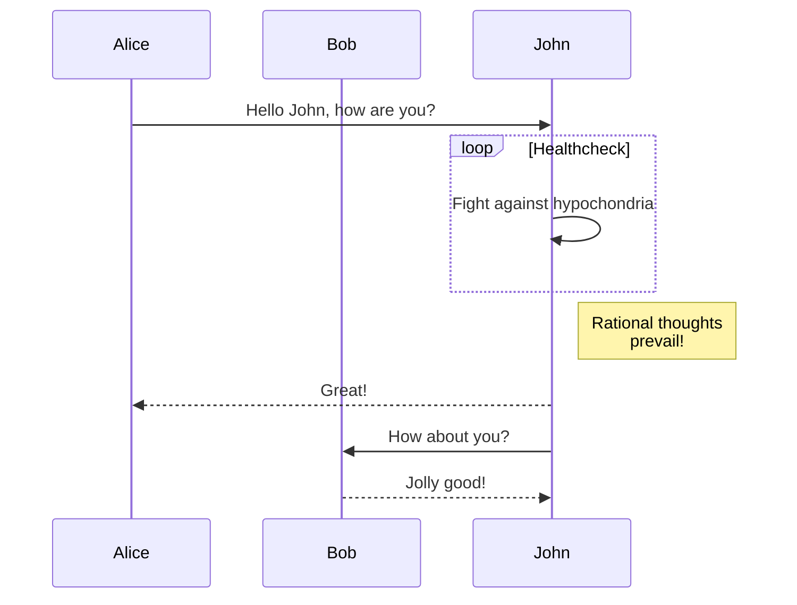
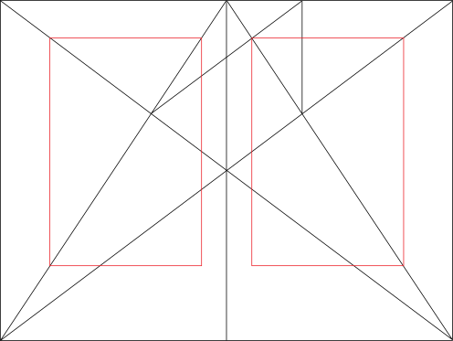

+++
title = "Components"
date = "2022-10-20"
description = "The Kita theme components."
[taxonomies]
tags = ["markdown", "css", "html"]
[extra]
mermaid = true
+++

The Kita theme provides multiple Tera components.

Zola 0.23 replaced shortcodes with components. See [Zola documentation](https://www.getzola.org/documentation/content/overview/#migrating-from-shortcodes) for more information.

## Mermaid

To use Mermaid in your page, you have to set `extra.mermaid = true` in the frontmatter of page.



```markdown
+++
title = "Your page title"

[extra]
mermaid = true
+++
```



Then you can use the `mermaid` component like:



```markdown


graph TD;
A-->B;
A-->C;
B-->D;
C-->D;


```



This will be rendered as:



graph TD;
A-->B;
A-->C;
B-->D;
C-->D;



In addition, you can use code block inside `mermaid` component and the code block will be ignored.

The code block prevents formatter from breaking mermaid's formatting.



````markdown





````



This will be rendered as:






## Admonition

The `admonition` component displays a banner to help you put notice in your page.

This is another way to write a GitHub-style alert, but it supports custom titles.

You can use the `admonition` component like:



```markdown

The `note` admonition.

```




The `note` admonition.



The `tip` admonition.



The `important` admonition.



The `warning` admonition.



The `caution` admonition.


## Gallery

The `gallery` component is very simple html-only clickable picture gallery that displays all images from the page assets.

It's from [Zola documentation](https://www.getzola.org/documentation/content/image-processing/)



```markdown

```





## Inline SVG

The `inline_svg` component is used to embed SVG images directly into a webpage, rather than including them via an `` tag.

You can use the `inline_svg` component like:



```markdown



```







If you don't want to display a caption below the image, you can set the Markdown image `alt` text to an empty string, `Inline SVG`, `inline-svg`, or `inline_svg`.



```markdown















```






